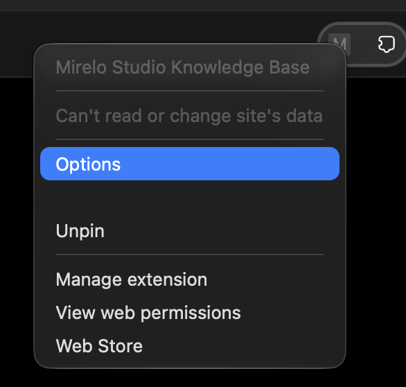
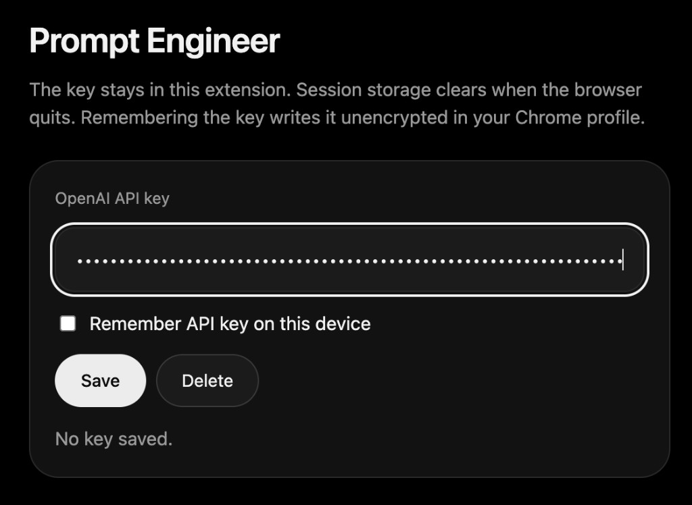
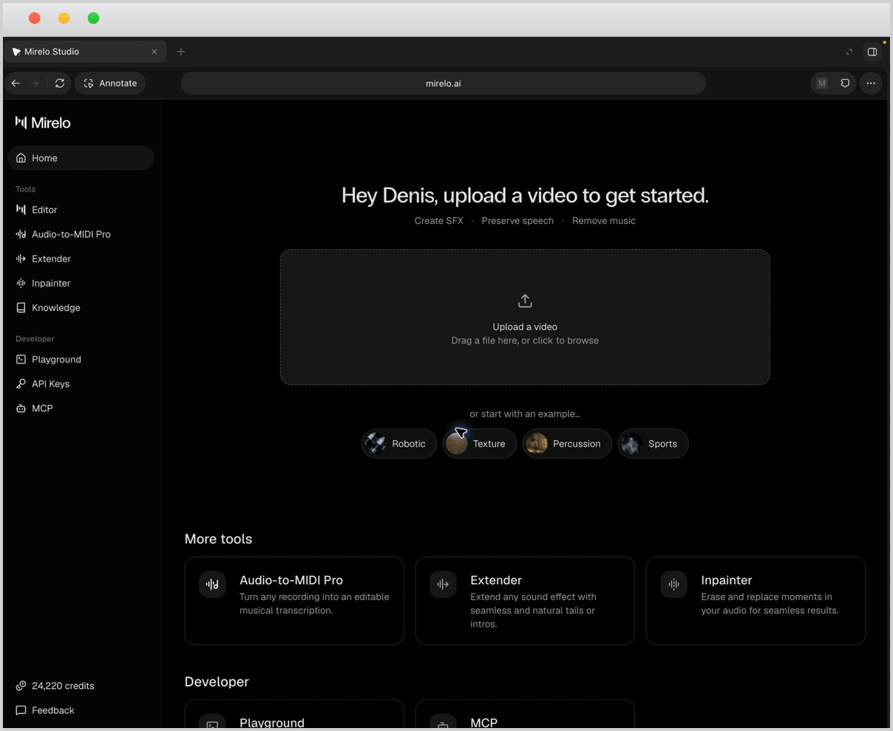
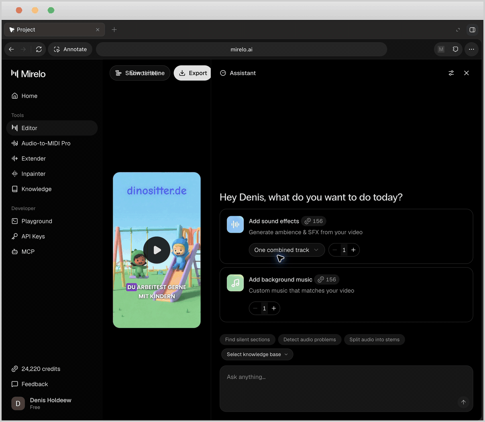
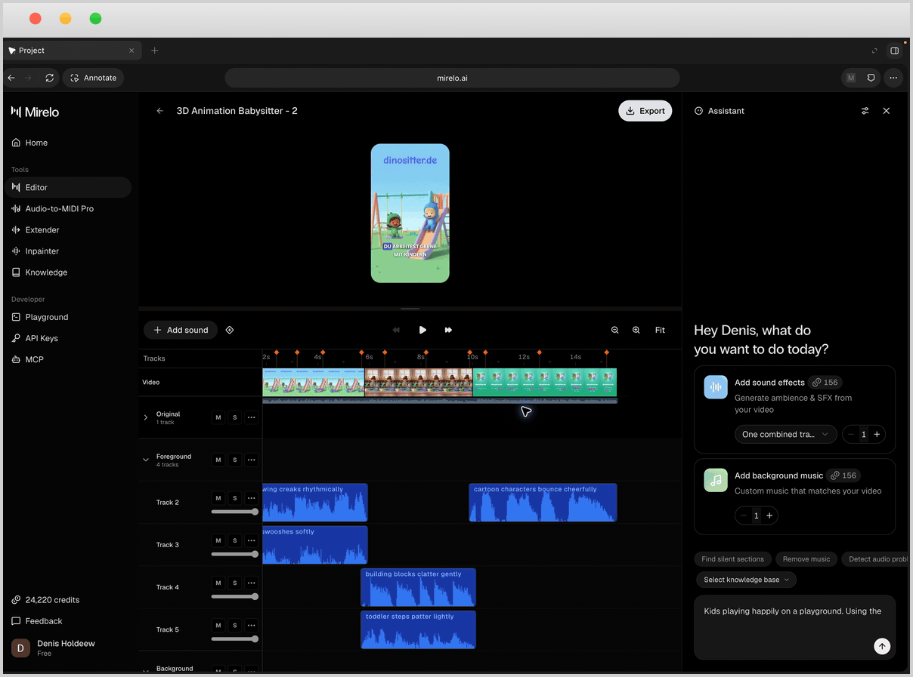
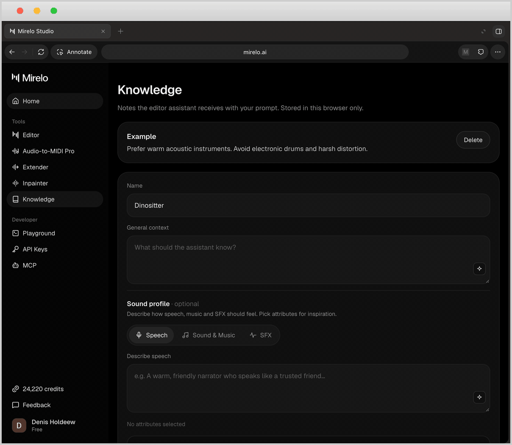

# mirelo-studio-smart-agent

A fully functional Chrome plugin for named knowledge bases in the [Mirelo Studio](https://mirelo.ai/studio) Assistant.

This is a showcase of how that feature could look:

&nbsp;You can create knowledge bases that act as a baseline for consistent sound generation.

&nbsp;You can use the knowledge bases across projects for company-wide consistency.

&nbsp;You can let the Prompt Engineer analyze your prompt and optimize it for efficiency and accuracy.
<br>
&nbsp;The plugin is fully functional, yet NOT production ready. Treat it as a developer tool:

1. Make sure to set spend limits and expiration dates for the OpenAI API key. The key is isolated in local or session storage, but anyone who can access your Chrome profile can read it.
2. The knowledge base is stored in local storage, so it persists only in this browser.

## Install

1. Open `chrome://extensions`.
2. Turn on Developer mode.
3. Choose **Load unpacked** and select the `extension` folder in this repo.
4. Open Mirelo Studio and sign in.
5. If you want to try out the ai-prompt-engineer that optimizes user prompts, make sure to add an API key: right-click the extension, choose **Options**, and add an OpenAI API key.

<p>
  
  &nbsp;
  
</p>

If you change the extension, click **Reload** on its card, then refresh Studio.

## Features

<h3> &nbsp;&nbsp;Adding knowledge bases</h3>

Create knowledge bases that can be used across projects:

&emsp;&emsp;&nbsp;General description and instructions about the project

&emsp;&emsp;&nbsp;Specific descriptions for SFX, speech, and music

&emsp;&emsp;&nbsp;Get inspiration: build prompts from ready-made components for SFX, speech, and music

<p></p>

<h3> &nbsp;&nbsp;Create knowledge bases directly from Chat</h3>

Conveniently create knowledge bases on the go:

&emsp;&emsp;&nbsp;Create knowledge bases while chatting with the Mirelo Assistant

&emsp;&emsp;&nbsp;View knowledge base contents while chatting with the Assistant

<p></p>

<h3> &nbsp;&nbsp;Produce consistent sounds</h3>

&emsp;&emsp;&nbsp;Select the knowledge base in your chats with the Mirelo Assistant

&emsp;&emsp;&nbsp;The Mirelo Assistant will use the information as always-on context for consistent sound generation

<p></p>

<h3> &nbsp;&nbsp;Prompt Engineer*</h3>

Add an OpenAI API key in the extension options before using this feature.

&emsp;&emsp;&nbsp;Analyze your prompts

&emsp;&emsp;&nbsp;Get suggestions for optimized prompts that generate better SFX, speech and music

<p></p>

## Implementation

The extension runs on `https://mirelo.ai/studio`. Knowledge opens on the current Studio URL with the `#knowledge` hash, so a refresh stays on a real page.

Notes are kept in `localStorage`. When a base is selected, a send places this at the start of the draft and then lets Studio send it:

```
[Knowledge base: Name]
general context

Speech:
how the voice should feel
Attributes: Warm, Calm

Sound & Music:
Attributes: Ambient, Gentle
---
your prompt
```

Studio sends the editor's own draft, so the notes are written through that editor. The extension does not make its own assistant request, and it does not read sign-in tokens.

Prompt Engineer calls OpenAI from the extension service worker. Save your own API key in the extension options. The key is not in this repo, and the Studio page never receives it. With no key saved, optimize asks you to add one.

It finds the assistant from the input, the composer, and the send button. A Studio update that renames those will need a matching change here.

## Technical Considerations

A Chrome extension is the approach in this repo. It stays in place across reloads, can write into the assistant draft on the live page, and keeps the notes in the browser. The `extension` folder loads on its own, with no extra tool required.

Other options:

- **Userscript.** Same kind of page update, but only for people who already run something like Tampermonkey.
- **Bookmarklet.** Drops out on the first navigation inside Studio, so the sidebar item and the selector would not stay.
- **Embedding Studio in another page.** Blocked. The site sends `X-Frame-Options: DENY` and `frame-ancestors 'none'`.
- **A standalone copy of the Studio screens.** Can show the controls, and cannot send through the real assistant.
- **A local proxy that rewrites the site.** Has to deal with sign-in, streaming, and TLS, and does not improve on the extension.
