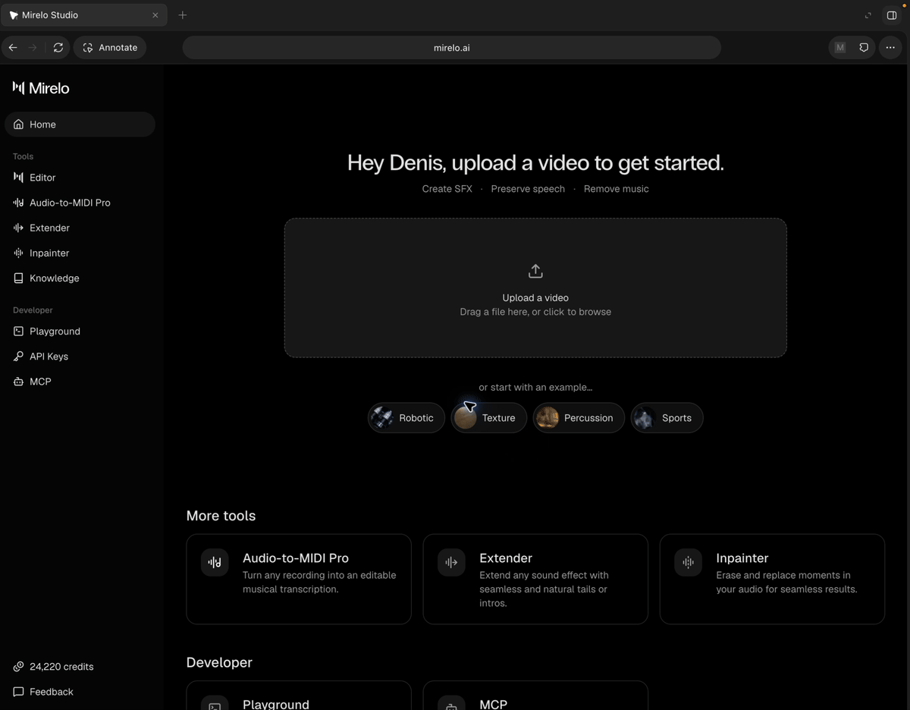

# mirelo-studio-smart-agent

Named knowledge bases for the [Mirelo Studio](https://mirelo.ai/studio) assistant.

This is a showcase of how that feature could look. It is not a production part of Studio. Your notes stay in the browser, and a selected base is sent with the assistant prompt.

## Features

### Adding knowledge bases

Create knowledge bases that can be used across projects:

 &nbsp;&nbsp;General description and instructions about the project

 &nbsp;&nbsp;Specific descriptions for SFX, speech, and music

 &nbsp;&nbsp;Get inspiration: build prompts from ready-made components for SFX, speech, and music



### Selecting a base

A selector above the editor assistant reads **Select knowledge base** until you pick one. **None** clears the selection and closes the menu. **Add +** opens the same form in a dialog. Saving there creates the base and selects it.

The next prompt includes the selected base (its name, general context, and any filled sound profile) followed by your own text. Choose **None** when you do not want the base included.

Notes are stored in this browser only.

Keep the notes short. Studio refuses a message longer than 4000 characters, and the notes count toward that limit. Sending still goes through the Studio assistant, so it uses credits the same way a normal prompt does.

## Install

1. Open `chrome://extensions`.
2. Turn on Developer mode.
3. Choose **Load unpacked** and select the `extension` folder in this repo.
4. Open Mirelo Studio and sign in.

If you change the extension, click **Reload** on its card, then refresh Studio.

## Implementation

The extension runs on `https://mirelo.ai/studio`. Knowledge opens on the current Studio URL with the `#knowledge` hash, so a refresh stays on a real page.

Notes are kept in `localStorage`. When a base is selected, a send places this at the start of the draft and then lets Studio send it:

```
[Knowledge base: Name]
general context

Speech:
how the voice should feel
Attributes: Warm, Calm

Sound & Music:
Attributes: Ambient, Gentle
---
your prompt
```

Studio sends the editor's own draft, so the notes are written through that editor. The extension does not make its own assistant request, and it does not read sign-in tokens.

It finds the assistant from the input, the composer, and the send button. A Studio update that renames those will need a matching change here.

## Technical Considerations

A Chrome extension is the approach in this repo. It stays in place across reloads, can write into the assistant draft on the live page, and keeps the notes in the browser. The `extension` folder loads on its own, with no extra tool required.

Other options:

- **Userscript.** Same kind of page update, but only for people who already run something like Tampermonkey.
- **Bookmarklet.** Drops out on the first navigation inside Studio, so the sidebar item and the selector would not stay.
- **Embedding Studio in another page.** Blocked. The site sends `X-Frame-Options: DENY` and `frame-ancestors 'none'`.
- **A standalone copy of the Studio screens.** Can show the controls, and cannot send through the real assistant.
- **A local proxy that rewrites the site.** Has to deal with sign-in, streaming, and TLS, and does not improve on the extension.
